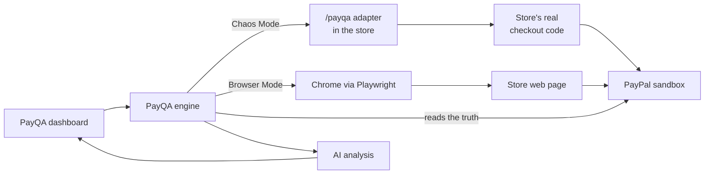

# PayQA

**Break your PayPal checkout before your customers do.**

PayQA tests a store's PayPal checkout before it goes live. It makes PayPal decline cards, refuse transactions and fail mid-payment, walks through checkout like a real customer, and checks what the store actually did. Then it explains every problem, shows the fix, and gives the checkout a Payment Readiness Score.

Built for the PayPal AI Hackathon 2026.

## The problem

Most stores only test the happy path: a card that works, a payment that goes through. The expensive bugs live in everything else:

- A declined card, but the customer still sees "Payment successful!" and the order ships unpaid.
- The order is marked paid before PayPal confirms, so the books are wrong when the capture fails.
- A double-click or network retry records the payment twice.
- A coupon shows in the cart, but PayPal is charged the full price.

These are hard to test by hand, because you'd need PayPal to fail on demand. PayQA uses PayPal's sandbox negative testing to make that happen, then checks the store's response against what PayPal says really happened.

## What it does

| | |
|---|---|
| **Chaos Mode** | Calls the store's real checkout code while PayPal is forced to decline, refuse or error. Checks what the customer was told, whether the order was marked paid, whether stock and payments changed, and whether the amount PayPal charges matches the cart. 7 scenarios, about 20 seconds. |
| **Browser Mode** | Opens Chrome with Playwright, shops like a customer, logs into the real PayPal sandbox popup and pays. Checks the success message, compares the on-screen total with what PayPal charges, and tests cancelling in the popup. Takes screenshots as evidence. |
| **AI analysis** | Claude explains each problem using the run's real evidence (what was expected, what actually happened), why it matters, and the code fix. PayQA decides what failed and how severe it is; Claude explains. Without an API key, or if the API is unavailable, PayQA uses built-in explanations so a run never breaks. |
| **Readiness score** | A weighted score (critical issues count most) and a go/no-go verdict: *Cleared for go-live* or *Not ready to go live*. |
| **PayQA Adapter** | One file that connects any Node.js + Express store to PayQA. PayQA then tests that store's real checkout code. |

### Results on the demo store

The repo includes a demo store, "Lanka Crafts", with 4 deliberate bugs, and a fixed version of the same store.

| Store | Chaos | Browser | Full |
|---|---|---|---|
| Demo store, buggy | 14/100 | 85/100 | 38/100 |
| Demo store, fixed (`npm run store:fixed`) | 100/100 | 100/100 | 100/100 |
| Minimal example store | 100/100 (coupon test skipped) | not supported (no shop page) | 100/100 |

## How it works



1. **Chaos Mode** sends test requests to the store's `/payqa` adapter. For failure tests it adds a mock code (for example `INSTRUMENT_DECLINED`). The store's own PayPal calls pick this up through `payqaPayPalHeaders()`, and PayPal's sandbox returns the real error.
2. The engine then reads the order **directly from PayPal's API**. PayPal is the source of truth: if the store says *PAID* but PayPal says the order was never captured, that's a bug.
3. **Browser Mode** drives the shop page and the real PayPal popup, and checks the result the same way.
4. Results are scored, analysed and shown on a receipt-style report.

### PayPal APIs used

- **Orders v2:** create, capture and look up orders
- **Sandbox negative testing** (`PayPal-Mock-Response`) to force declines, refusals and server errors
- **JavaScript SDK** for the PayPal button in the demo store
- **OAuth 2.0** client credentials
- **`PayPal-Request-Id`** for idempotent captures (in the example store)

## Run it yourself

You need **Node.js 18+** and a free **PayPal developer account**. Setup takes about 10 minutes.

### 1. Get PayPal sandbox credentials

1. Log in at [developer.paypal.com](https://developer.paypal.com) and switch to **Sandbox**.
2. **Testing Tools → Sandbox Accounts → Create account:** create a **Business** and a **Personal** account, both with country **United States**.
3. **Apps & Credentials → Create App:** type **Merchant**, linked to the US business account. Copy the **Client ID** and **Secret**.
4. Open the US Personal account (**⋮ → View/edit account**) and note its email and password. That's the test buyer.

### 2. Install

```bash
git clone https://github.com/sajithkhan/payqa.git
cd payqa
npm run setup
```

`npm run setup` installs the packages and the Chromium browser that Browser Mode uses.

### 3. Configure

Copy `.env.example` to `.env` and fill in the values from step 1:

```bash
cp .env.example .env          # macOS / Linux
copy .env.example .env        # Windows
```

### 4. Start

In three terminals:

```bash
npm run store         # demo store with the 4 bugs:  http://localhost:4000
npm run store:fixed   # same store, bugs fixed:      http://localhost:4001
npm run payqa         # PayQA dashboard:             http://localhost:5000
```

Open **http://localhost:5000**, click **Demo store (buggy)**, pick **Chaos**, and press **Run tests**. Then click **Demo store (fixed)** and run again to see it go green.

### Optional: the minimal example store

```bash
npm run example     # http://localhost:4100
```

In the dashboard, click **Minimal store** (it fills in the URL and its access token) and run **Chaos**.

### Command line

```bash
npm run chaos                                  # Chaos Mode on the demo store
npm run browser                                # Browser Mode
node server/cli.mjs full                       # both
node server/cli.mjs chaos http://localhost:4100   # another store
```

## Test your own store

Add the **PayQA Adapter** to your store's staging server: copy one file, add one line to your PayPal calls, and mount it at `/payqa`. It's off by default, only works with the PayPal sandbox, and can be protected with a token.

Full guide: [adapter/README.md](adapter/README.md)

## Scenarios

**Chaos Mode**

| Scenario | What it checks |
|---|---|
| Card declined at capture | No false success, order not marked paid, no stock taken, no payment recorded |
| Transaction refused by PayPal | Same checks for a refused transaction |
| PayPal server error during capture | The store handles a PayPal outage without claiming success |
| Customer retries after a failed payment | A second capture call doesn't double-record the payment or stock |
| Coupon discount reaches PayPal | PayPal charges the discounted total the customer saw |
| Amount matches without a coupon | Control test: normal carts send the exact total |
| Invalid cart is rejected | Zero quantities and unknown products never reach PayPal |

**Browser Mode**

| Scenario | What it checks |
|---|---|
| Customer completes a PayPal checkout | Success message, PayPal capture COMPLETED, order PAID, stock updated |
| PayPal shows the same total the customer saw | On-screen total vs the amount PayPal will charge |
| Customer cancels in the PayPal popup | No success message, order not paid, stock unchanged |

## Project structure

```
adapter/            PayQA Adapter: the file merchants add to their store
demo-store/         Lanka Crafts demo store with 4 planted bugs (--fixed removes them)
examples/
  minimal-store/    A second, bug-free store connected through the adapter
server/
  chaos/            Chaos Mode scenarios and runner
  browser/          Browser Mode (Playwright) scenarios and runner
  ai/               AI analysis of each run
  lib/              PayPal and store clients
  public/           Dashboard (HTML, CSS, JS)
  index.mjs         Dashboard + API server
  cli.mjs           Command-line runner
```

## Tech stack

Node.js, Express, PayPal Orders v2 + JavaScript SDK (sandbox), Playwright, Claude (Anthropic) for AI analysis, plain HTML/CSS/JS dashboard.

## Limits and what's next

- The adapter is for **Node.js + Express** for now. Adapters for PHP, Python and Java, and plugins for WooCommerce and Shopify, are next.
- **Browser Mode** currently knows the demo store's page layout. The plan is to use AI to find the cart and PayPal button on any shop page.
- PayQA is for **sandbox and staging only**. It never runs against live payments.

## License

[MIT](LICENSE)
